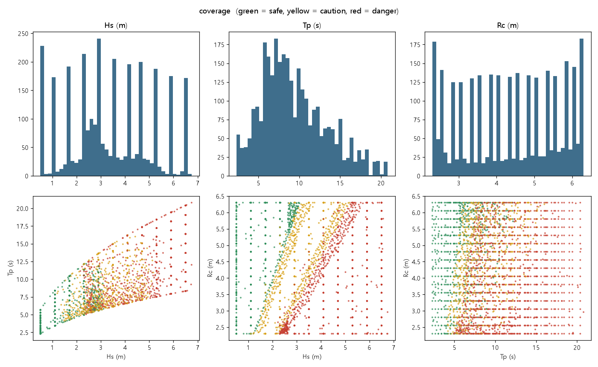

# [1차] 학습 데이터 검증 리포트

- 설정 파일 해시 `6428439352cd` · 데이터 해시 `ddd767d406ea` · 시드 2026

## 건수
- 학습용 3000건: 격자(A) 1870, 경계 집중(B) 930, 범위 가장자리(C) 200
- 분할: train 2100, val 450, test 450
- 평가 전용: 경계 시험 300건, 범위 밖 시험 200건

## 입력 범위
| 변수 | 설정 범위 | 실제 데이터 범위 |
|---|---|---|
| hs | 0.50 ~ 6.83 | 0.50 ~ 6.75 |
| tp | 2.31 ~ 20.91 | 2.31 ~ 20.80 |
| rc | 2.30 ~ 6.30 | 2.30 ~ 6.30 |

실제 범위가 설정보다 좁으면 쇄파 한계 필터 때문입니다.

## 층화: 영역 × 등급 9칸
### 격자(A)
|     |   안전 |   주의 |   위험 |
|:----|-----:|-----:|-----:|
| 비쇄파 |  534 |  133 |   13 |
| 전환  |   15 |  287 |  378 |
| 쇄파  |    0 |    0 |  510 |

### 전체
|     |   안전 |   주의 |   위험 |
|:----|-----:|-----:|-----:|
| 비쇄파 |  681 |  282 |  109 |
| 전환  |  120 |  610 |  627 |
| 쇄파  |    0 |    0 |  571 |

- 격자에 한 건도 없는 칸 (물리적으로 생기지 않는 조합): 쇄파×안전, 쇄파×주의
- 최소 건수(100) 미달 칸 (전체 기준, 격자에서 모자란 칸은 B에서 보충): 없음
- 등급 비율: 안전 26.7%, 주의 29.7%, 위험 43.6% (목표: 각 15% 이상, 45% 이하)
- 건물 피해 표시 비율: 68.2%
- 월파 없음(q = 0) 비율: 17.8%

## 최근접 이웃 거리 (정규화 입력공간)
- 최소 0.0101, 5% 0.0132, 중앙값 0.0318, 최대 0.0627
- 중복 기준(0.01) 미만: 0건

## 물리 일관성
```json
{
 "Tp=6.0s": {
  "Hs가 커지는데 q가 줄어든 격자": 0,
  "Rc가 커지는데 q가 늘어난 격자": 0
 },
 "Tp=10.0s": {
  "Hs가 커지는데 q가 줄어든 격자": 0,
  "Rc가 커지는데 q가 늘어난 격자": 0
 },
 "Tp=15.0s": {
  "Hs가 커지는데 q가 줄어든 격자": 0,
  "Rc가 커지는데 q가 늘어난 격자": 0
 }
}
```

## 분할별 분포
| split   |   hs mean |   hs std |   tp mean |   tp std |   rc mean |   rc std |
|:--------|----------:|---------:|----------:|---------:|----------:|---------:|
| test    |     3.372 |    1.69  |     9.341 |    3.943 |     4.369 |    1.288 |
| train   |     3.369 |    1.699 |     9.323 |    3.93  |     4.351 |    1.256 |
| val     |     3.355 |    1.697 |     9.546 |    3.983 |     4.313 |    1.231 |

| split   |    안전 |    주의 |    위험 |
|:--------|------:|------:|------:|
| test    | 0.267 | 0.298 | 0.436 |
| train   | 0.267 | 0.297 | 0.436 |
| val     | 0.267 | 0.298 | 0.436 |

## 불가능 모서리 (C)
|    |   hs |    tp |   rc | 사유     |
|---:|-----:|------:|-----:|:-------|
|  0 |    7 | 21.17 |  2.3 | 쇄파한계초과 |
|  1 |    7 | 21.17 |  6.3 | 쇄파한계초과 |
|  2 |    7 |  8.64 |  2.3 | 쇄파한계초과 |
|  3 |    7 |  8.64 |  6.3 | 쇄파한계초과 |

## 필터 로그
| 단계   | 항목         |   건수 | 사유                          |
|:-----|:-----------|-----:|:----------------------------|
| A    | 격자 생성      | 1870 | 파고 11 × 주기 10 × 여유고 17      |
| A    | 선택         | 1870 |                             |
| C    | 선택         |  200 |                             |
| C    | 불가능 모서리    |    4 |                             |
| B    | 칸 최소 건수 보충 |  167 | 비쇄파×위험, 전환×안전, 쇄파×안전, 쇄파×주의 |
| B    | 후보 생성      | 4096 |                             |
| B    | 경계 ±0.4 채택 |  763 |                             |
| EB   | 후보 생성      | 4096 |                             |
| EB   | 경계 ±0.2 채택 |  300 |                             |
| OUT  | 선택         |  200 |                             |

