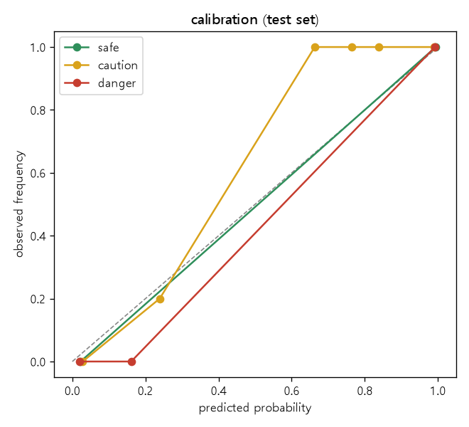

# [2차] Random Forest 평가 리포트

## 요약 (시험 세트)
- 등급 정확도 98.9%, 등급 macro-F1 98.9%, 위험을 안전으로 오판 0건, 위험을 안전·주의로 과소판정 2건
- 5겹 교차검증(trval): 정확도 97.7% ± 0.3%, macro-F1 97.6% ± 0.4%; 겹별 정확도 97.5%, 97.8%, 98.0%, 98.0%, 97.2%
- 등급별 재현율: 안전 99.2%, 주의 98.5%, 위험 99.0%
- 확률 신뢰도: Brier 0.0165 (0에 가까울수록 좋음), ECE 0.0236 (예측 확률과 실제 정답률의 평균 차이)
- 건물 피해 정확도 98.7%, 놓친 건수 5건

## 전체 결과
```json
{
 "선택한 설정": {
  "max_depth": null,
  "min_samples_leaf": 1,
  "n_estimators": 200
 },
 "하이퍼파라미터 탐색(검증 세트)": [
  {
   "max_depth": null,
   "min_samples_leaf": 1,
   "위험 재현율": 0.9745,
   "정확도": 0.9733,
   "Brier": 0.0343
  },
  {
   "max_depth": null,
   "min_samples_leaf": 3,
   "위험 재현율": 0.9694,
   "정확도": 0.9733,
   "Brier": 0.039
  },
  {
   "max_depth": null,
   "min_samples_leaf": 5,
   "위험 재현율": 0.9643,
   "정확도": 0.9689,
   "Brier": 0.045
  },
  {
   "max_depth": 12,
   "min_samples_leaf": 1,
   "위험 재현율": 0.9745,
   "정확도": 0.9733,
   "Brier": 0.0343
  },
  {
   "max_depth": 12,
   "min_samples_leaf": 3,
   "위험 재현율": 0.9694,
   "정확도": 0.9733,
   "Brier": 0.0391
  },
  {
   "max_depth": 12,
   "min_samples_leaf": 5,
   "위험 재현율": 0.9643,
   "정확도": 0.9689,
   "Brier": 0.045
  },
  {
   "max_depth": 8,
   "min_samples_leaf": 1,
   "위험 재현율": 0.9745,
   "정확도": 0.9733,
   "Brier": 0.0367
  },
  {
   "max_depth": 8,
   "min_samples_leaf": 3,
   "위험 재현율": 0.9643,
   "정확도": 0.9711,
   "Brier": 0.0411
  },
  {
   "max_depth": 8,
   "min_samples_leaf": 5,
   "위험 재현율": 0.9643,
   "정확도": 0.9689,
   "Brier": 0.0459
  }
 ],
 "확률 보정": {
  "grade": {
   "보정 전 Brier": 0.0343,
   "보정 후 Brier": 0.0479,
   "보정 사용": false
  },
  "building": {
   "보정 전 Brier": 0.007,
   "보정 후 Brier": 0.0104,
   "보정 사용": false
  }
 },
 "시험 세트": {
  "건수": 450,
  "등급 정확도": 0.9889,
  "등급 macro-F1": 0.9885,
  "등급별 재현율": {
   "안전": 0.9917,
   "주의": 0.9851,
   "위험": 0.9898
  },
  "위험을 안전으로 오판": 0,
  "위험을 안전·주의로 과소판정": 2,
  "등급 Brier 점수": 0.0165,
  "등급 ECE": 0.0236,
  "건물 피해 정확도": 0.9867,
  "건물 피해 놓침(실제 있음→없음)": 5,
  "건물 피해 Brier 점수": 0.0162,
  "혼동행렬(행=실제, 열=예측)": [
   [
    119,
    1,
    0
   ],
   [
    1,
    132,
    1
   ],
   [
    0,
    2,
    194
   ]
  ]
 },
 "경계 시험 세트": {
  "건수": 300,
  "등급 정확도": 0.9533,
  "등급 macro-F1": 0.9356,
  "등급별 재현율": {
   "안전": 1.0,
   "주의": 0.9465,
   "위험": 0.9565
  },
  "위험을 안전으로 오판": 0,
  "위험을 안전·주의로 과소판정": 4,
  "등급 Brier 점수": 0.0888,
  "등급 ECE": 0.066,
  "건물 피해 정확도": 0.96,
  "건물 피해 놓침(실제 있음→없음)": 3,
  "건물 피해 Brier 점수": 0.0593,
  "혼동행렬(행=실제, 열=예측)": [
   [
    21,
    0,
    0
   ],
   [
    5,
    177,
    5
   ],
   [
    0,
    4,
    88
   ]
  ]
 },
 "범위 밖 시험 세트": {
  "건수": 200,
  "등급 정확도": 0.99,
  "등급 macro-F1": 0.9885,
  "등급별 재현율": {
   "안전": 1.0,
   "주의": 0.9767,
   "위험": 0.9888
  },
  "위험을 안전으로 오판": 0,
  "위험을 안전·주의로 과소판정": 1,
  "등급 Brier 점수": 0.028,
  "등급 ECE": 0.0361,
  "건물 피해 정확도": 0.99,
  "건물 피해 놓침(실제 있음→없음)": 0,
  "건물 피해 Brier 점수": 0.0196,
  "혼동행렬(행=실제, 열=예측)": [
   [
    68,
    0,
    0
   ],
   [
    0,
    42,
    1
   ],
   [
    0,
    1,
    88
   ]
  ]
 },
 "특성 중요도": {
  "hs": 0.2049,
  "tp": 0.0764,
  "rc": 0.0598,
  "rc_over_hs": 0.6327,
  "s_p": 0.0262
 },
 "5겹 교차검증": {
  "정확도 평균": 0.9773,
  "정확도 표준편차": 0.0032,
  "macro-F1 평균": 0.9761,
  "macro-F1 표준편차": 0.0039,
  "겹별 정확도": [
   0.9745,
   0.9784,
   0.9804,
   0.9804,
   0.9725
  ]
 }
}
```

## 확률 신뢰도 그림
점선(대각선)에 가까울수록 확률 %가 믿을 만합니다.



범위 밖 시험 세트는 학습 범위를 벗어난 입력입니다. 대시보드는 이 경우 경고와 함께 경험식 결과를 기준으로 보여 줍니다.